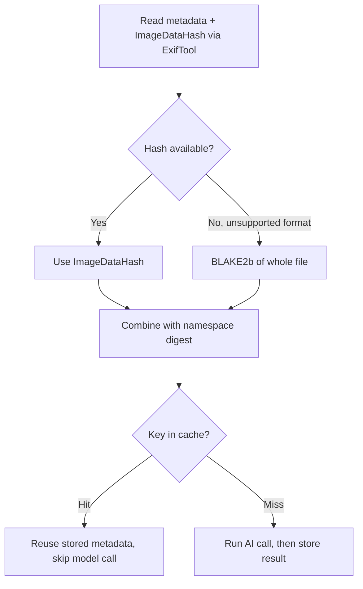

# Caching and locking

Two optional artifacts make repeated runs faster and safer: a SQLite cache that skips redundant
model calls, and a cross-platform lock that stops two runs from racing on the same folder. Both are
opt-in and controlled by a single flag each.

## Caching

[`cache.py`](https://github.com/jbsilva/photo-tagger/blob/main/src/photo_tagger/cache.py) provides
`InferenceCache`, a SQLite database opened in WAL (write-ahead logging) mode. Enable it with
`--cache-file PATH`. If the file does not exist, photo-tagger creates it. A cache hit skips the
model call, so reruns on an unchanged folder are fast and free. The one exception is
`--repair-language` (see [below](#what-the-key-leaves-out)).

This page is the full description of the cache. Other pages give a short summary and link here.

### Cache key

Each entry is keyed by two parts:

| Part             | What it is                                                                                     |
| ---------------- | ---------------------------------------------------------------------------------------------- |
| Image-data hash  | ExifTool's `ImageDataHash` over the image stream only, or a hash of the whole file as fallback |
| Namespace digest | The model name, plus a digest of the user prompt, the output language, and the image settings  |

The image-data hash deliberately ignores metadata. ExifTool hashes only the image stream, not the
EXIF/XMP/IPTC blocks around it. So writing keywords, a title, or a description into a photo does not
change the key. That is what makes the cache survive `--embed-in-photo`. The first run tags the file
and stores the result. A later run over the same folder still hits the cache, even though the bytes
of the file changed. It is read in the same ExifTool call that already collects existing metadata,
so a hit costs no extra subprocess. For a format that ExifTool cannot hash that way, photo-tagger
uses a BLAKE2b digest of the whole file. For those files, embedding metadata does change the key. If
the file cannot be read for the hash, the photo runs without the cache.

`build_cache_namespace()` makes the namespace from these inputs:

- The model name.
- The user prompt. This includes `--prompt-file`, `--hint`, and the term list of `--vocabulary`,
    because all three go into the prompt.
- `--output-language`.
- `--temperature` and `--frequency-penalty`.
- `--jpeg-dimensions` and `--jpeg-quality`.

When the photo and all of these inputs stay the same, the run reuses the cached result. Change any
of them, and the run writes fresh entries. The old ones are never looked up again.

### What the key leaves out

- `--max-tokens`, on purpose. The cap can only stop an answer: an answer that reaches it fails
    validation and never goes into the cache. So you can raise or lower the cap (for example, to get
    out of a model that repeats itself) and keep your cache.
- The system prompt. It ships with the code and changes only with a photo-tagger upgrade.
- The context of each photo: its existing keywords, location, GPS, and camera EXIF. The prompt gets
    them after the namespace is made. So a photo whose keywords changed, but whose pixels did not,
    still replays the old answer.
- The repair setting. A cached answer that mixes writing systems is checked again on each replay.
    With `--repair-language`, photo-tagger sends it to the model again, and a fixed answer replaces
    it in the cache. See [mixed-language output](../usage/cli-reference.md#mixed-language-output).

### Lookup flow



### Managing the cache

When the cache opens, photo-tagger deletes the entries that were written more than 180 days ago.
Every change of settings starts a new namespace, so without this the file would only grow.

The cache file is safe to delete at any time. The next run repopulates it. Deleting it costs you
only the model calls it skips, and never touches any metadata already written to your photos. When
you switch models, you do not need to clear the cache, because changing the model or the prompt
already produces a different namespace digest. Stale entries are never looked up again.

!!! tip "Combine `--cache-file` across reruns"

    Point every run at the same `--cache-file` to get the most out of it. A first pass tags the folder
    and fills the cache. A later rerun, for example after adding a few new photos or bumping up
    `--workers`, reuses the stored results for every unchanged image. It only calls the model for new or
    changed photos.

## Locking

[`locking.py`](https://github.com/jbsilva/photo-tagger/blob/main/src/photo_tagger/locking.py)
provides `FileLock`, a thin wrapper over the `filelock` library that works on Linux, macOS, and
Windows. Enable it with `--lock-file PATH`, for `tag` and for `watch`. `tag` holds the lock for the
whole run, and `watch` holds it for as long as it watches.

The lock is exclusive and non-blocking. photo-tagger calls `acquire(timeout=0)`. If another
photo-tagger process already holds the lock, the call raises `LockHeldError` and refuses to start
instead of waiting. This guarantees that two runs cannot race on the same folder and write
conflicting metadata at the same time.

```bash
# Point both runs at the same lock file; the second one refuses to start.
photo-tagger -i ~/Photos --lock-file ~/Photos/.photo-tagger.lock
```

!!! warning "Use one lock file per folder"

    The lock guards whatever you choose to protect, not the input path automatically. Always use the
    same `--lock-file` for runs that touch the same folder. Otherwise, two runs with different lock
    files will not see each other and can still overlap.

## Related pages

- [Processing pipeline](pipeline.md) shows where the cache lookup sits in `process_photo()`. The
    lock is taken before that, when the command starts.
- [CLI reference](../usage/cli-reference.md) lists `--cache-file` and `--lock-file` with their
    defaults.
