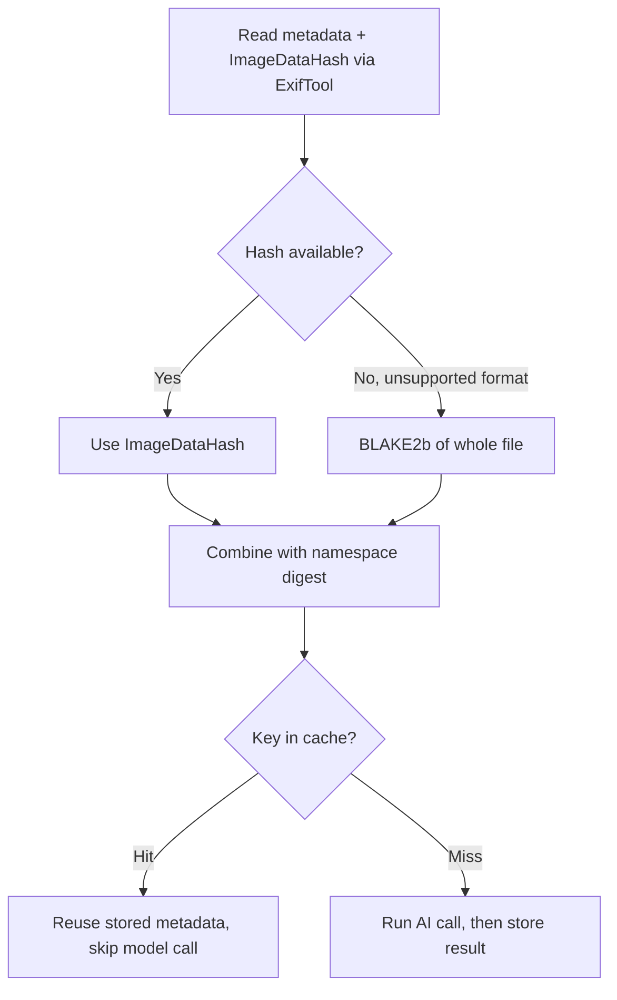

# Caching and locking

Two optional artifacts make repeated runs faster and safer: a SQLite cache that skips redundant
model calls, and a cross-platform lock that stops two runs from racing on the same folder. Both are
opt-in and controlled by a single flag each.

## Caching

[`cache.py`](https://github.com/jbsilva/photo-tagger/blob/main/src/photo_tagger/cache.py) provides
`InferenceCache`, a SQLite database opened in WAL (write-ahead logging) mode. Enable it with
`--cache-file PATH`. If the file does not exist, photo-tagger creates it. A cache hit skips the
model call entirely, so reruns on an unchanged folder are fast and free.

### Cache key

Each entry is keyed by two parts:

| Part             | What it is                                                                       |
| ---------------- | -------------------------------------------------------------------------------- |
| Image-data hash  | ExifTool's `ImageDataHash` over the image stream only, so identical pixels match |
| Namespace digest | A digest of the model name, user prompt, and sampling settings                   |

The image-data hash deliberately ignores metadata. ExifTool hashes only the decoded image stream,
not the EXIF/XMP/IPTC blocks around it. So writing keywords, a title, or a description into a photo
does not change the key. That is what makes the cache survive `--embed-in-photo`. The first run tags
the file and stores the result. A later run over the same folder still hits the cache, even though
the file's bytes changed. It is read in the same ExifTool call that already collects existing
metadata, so a hit costs no extra subprocess. Formats ExifTool cannot hash that way fall back to a
BLAKE2b digest of the whole file. For those, re-embedding metadata does produce a fresh key.

`build_cache_namespace()` produces the namespace digest from the model name, the user prompt, and
the sampling settings: `temperature`, `max_tokens`, `frequency_penalty`, `jpeg_dimensions`, and
`jpeg_quality`. The system prompt ships with the code and only changes across a photo-tagger
upgrade, so the digest intentionally leaves it out.

When both the image and every input that changes the model's answer stay the same, the split key
reuses a cached result. Change the model or the prompt, and you naturally get fresh entries. The old
ones are never looked up again.

### Lookup flow



### Managing the cache

The cache file is safe to delete at any time. The next run repopulates it. Deleting it costs you
only the model calls it skips, and never touches any metadata already written to your photos. When
you switch models, you do not need to clear the cache, because changing the model or the prompt
already produces a different namespace digest. Stale entries are never looked up again.

!!! tip "Combine `--cache-file` across reruns"

    Point every run at the same `--cache-file` to get the most out of it. A first pass tags the folder
    and fills the cache. A later rerun, for example after adding a few new photos or bumping up
    `--workers`, reuses the stored results for every unchanged image. It only calls the model for new or
    changed photos.

## Locking

[`locking.py`](https://github.com/jbsilva/photo-tagger/blob/main/src/photo_tagger/locking.py)
provides `FileLock`, a thin wrapper over the `filelock` library that works on Linux, macOS, and
Windows. Enable it with `--lock-file PATH`.

The lock is exclusive and non-blocking. photo-tagger calls `acquire(timeout=0)`. If another
photo-tagger process already holds the lock, the call raises `LockHeldError` and refuses to start
instead of waiting. This guarantees that two runs cannot race on the same folder and write
conflicting metadata at the same time.

```bash
# Point both runs at the same lock file; the second one refuses to start.
photo-tagger -i ~/Photos --lock-file ~/Photos/.photo-tagger.lock
```

!!! warning "Use one lock file per folder"

    The lock guards whatever you choose to protect, not the input path automatically. Always use the
    same `--lock-file` for runs that touch the same folder. Otherwise, two runs with different lock
    files will not see each other and can still overlap.

## Related pages

- [Processing pipeline](pipeline.md) shows where the cache lookup and lock acquisition sit in
    `run_batch()`.
- [CLI reference](../usage/cli-reference.md) lists `--cache-file` and `--lock-file` with their
    defaults.
