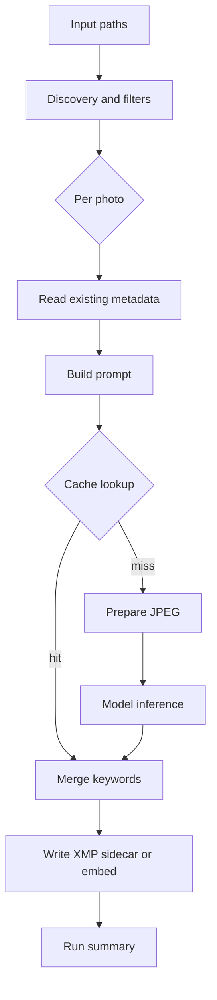

# Architecture

photo-tagger turns a set of input paths into Lightroom-compatible metadata. It sends each photo to a
vision-language model: a local one, a self-hosted one, or any OpenAI-compatible service. Then it
writes the result back as an XMP sidecar (the default) or embeds it in the image file.

We split the work into small, focused modules. As a result, you can test and understand each part on
its own: discovery, prompting, inference, caching, keyword merging, and metadata writing. This
section explains how those pieces fit together. The pages below go module by module. This overview
shows the high-level flow and a map of every module under `src/photo_tagger/`.

## High-level flow

The orchestrator resolves a batch of images. Then it sends each photo through the same sequence of
steps. A cache hit skips the model call, which is the slowest step.

The per-photo steps run inside `run_batch()`. `run_batch()` retries each failed photo once, in a
second pass. The final run summary reports the success and failure counts, the token usage, and the
wall time.

## Modules

Each module under `src/photo_tagger/` owns one part of the flow. The module names link to the source
on `main`. Table cells cannot hard-wrap, so the link targets live in the reference block below.

| Module                              | Responsibility                                                                                                                                                                                                                                                                                                                                                        |
| ----------------------------------- | --------------------------------------------------------------------------------------------------------------------------------------------------------------------------------------------------------------------------------------------------------------------------------------------------------------------------------------------------------------------- |
| [`main.py`][main]                   | The cyclopts entry point: the `tag()` default command (orchestration) plus the `doctor`, `watch`, and `undo` commands. It resolves the batch, acquires the lock, runs the batch, emits NDJSON, and writes the summary.                                                                                                                                                |
| [`cli_options.py`][cli_options]     | The CLI schema: the seven `@dataclass` flag groups, their defaults from the configuration file (`load_defaults`), and the `ProcessingOptions` mapping.                                                                                                                                                                                                                |
| [`gui.py`][gui]                     | The optional PySide6 desktop frontend (`photo-tagger gui`), a review-before-write window. A background `QThread` generates proposals with `create_agent`/`analyze_image_with_ai`, not with `run_batch`. The window writes on demand, and batch saves run on a second `QThread`. The CLI imports it lazily. We exclude it from coverage and from the static analyzers. |
| [`gui_state.py`][gui_state]         | The GUI's Qt-free logic (per-photo `PhotoItem` state, the folder tree, keyword parsing and diffing, and the hierarchy preview). Its unit tests run without a display or PySide6.                                                                                                                                                                                      |
| [`config.py`][config]               | Defaults, provider base URLs and keys, tag names, and the system and user prompts.                                                                                                                                                                                                                                                                                    |
| [`config_file.py`][config_file]     | The TOML loader: `find_config_file`, `load_config`, `apply_overrides`.                                                                                                                                                                                                                                                                                                |
| [`providers.py`][providers]         | The backend registry. A `ProviderBackend` (Strategy) for each backend bundles its listing URL, listing parser, and provider factory. Every backend reuses one copy of the shared HTTP plumbing. The module also hosts the `openai` backend.                                                                                                                           |
| [`discovery.py`][discovery]         | `resolve_image_batch()` expands the inputs and filters them by extension. `apply_skip_file`, `apply_date_filter`, and `apply_skip_tagged` narrow the batch.                                                                                                                                                                                                           |
| [`image_io.py`][image_io]           | `prepare_image_for_agent()` loads the image (rawpy for RAW, Pillow otherwise) and fixes its orientation. Then it flattens alpha to white, resizes the image, and JPEG-encodes the bytes that go to the model.                                                                                                                                                         |
| [`ai.py`][ai]                       | `create_agent()` builds a pydantic-ai Agent over an OpenAI-compatible model and makes sure that the model exists. `analyze_image_with_ai()` runs the agent and returns an `InferenceResult`.                                                                                                                                                                          |
| [`models.py`][models]               | `GeneratedMetadata` (it caps the title length, the description length, and the keyword count), `InferenceResult`, and `KeywordSet` (the typed keyword value object).                                                                                                                                                                                                  |
| [`keywords.py`][keywords]           | `parse_hierarchical_keyword()` converts the leaf-first form to the root-to-leaf pipe form that Lightroom uses. `merge_keywords()` merges keywords, removes duplicates (the comparison is case-insensitive), and keeps the hierarchy.                                                                                                                                  |
| [`diagnostics.py`][diagnostics]     | The checks behind `photo-tagger doctor`: ExifTool on PATH and provider/model reachability. Each check returns a `CheckResult`.                                                                                                                                                                                                                                        |
| [`metadata.py`][metadata]           | `read_image_context()` does one batched exiftool read. `build_contextual_prompt()` appends that context to the user prompt. `write_metadata()` writes the sidecar or embeds the metadata. `find_tagged_images()` finds tagged files.                                                                                                                                  |
| [`cache.py`][cache]                 | `InferenceCache`, a SQLite database (WAL mode). Its key is the image content hash plus a namespace digest. A cache hit skips the model call.                                                                                                                                                                                                                          |
| [`locking.py`][locking]             | `FileLock` wraps the filelock library for a cross-platform, non-blocking exclusive lock.                                                                                                                                                                                                                                                                              |
| [`pipeline.py`][pipeline]           | `run_batch()` orchestrates everything: serial or concurrent processing, the per-photo steps, retries, and the callbacks that stream the outcomes.                                                                                                                                                                                                                     |
| [`csv_report.py`][csv_report]       | `ReportRow` plus the streaming `CsvReportWriter` (CLI `--csv-file`) and the batch `write_report` (GUI export). Both write one spreadsheet row per photo, and both frontends share the column schema.                                                                                                                                                                  |
| [`progress.py`][progress]           | It shows a rich progress bar on stderr. If stderr is not a TTY, it does nothing.                                                                                                                                                                                                                                                                                      |
| [`logging_setup.py`][logging_setup] | The loguru configuration: a console sink to stderr (so that the NDJSON on stdout stays clean) and a rotating, compressed file sink.                                                                                                                                                                                                                                   |
| [`vocabulary.py`][vocabulary]       | The controlled vocabulary (`--vocabulary`). It parses a Lightroom keyword export or a plain term list. Then it snaps generated keywords onto the catalog's own spelling and hierarchy.                                                                                                                                                                                |
| [`sessions.py`][sessions]           | It groups a batch into shoots by capture time (`--session-gap`). Then it builds the vocabulary of each shoot from that shoot's own output, so that every frame of one subject agrees.                                                                                                                                                                                 |
| [`undo.py`][undo]                   | The per-run write journal and the restore logic behind `photo-tagger undo`.                                                                                                                                                                                                                                                                                           |
| [`watch.py`][watch]                 | The polling folder watcher behind `photo-tagger watch`. It yields each batch of new photos after they stop changing.                                                                                                                                                                                                                                                  |
| [`errors.py`][errors]               | `PhotoTaggerError` (base), `ProviderError`, `DiscoveryError`, `BatchError`, `VocabularyError`, `UndoError`.                                                                                                                                                                                                                                                           |

!!! note

    Serial runs (`--workers 1`) reuse one long-lived ExifTool process (`-stay_open`). Concurrent runs
    give each worker its own short-lived helper because pyexiftool's pipe is not thread-safe.

## Frontends

The CLI and the GUI are two frontends over the same building blocks. But they use these blocks at
different levels, because they have different goals.

The CLI ([`main.py`][main]) drives the batch through `run_batch()`. This function is the boundary
between the pipeline and a UI, and it does not depend on any UI. `run_batch()` takes a
`ProcessingOptions` bundle and reports back only through callbacks:

- `on_image_result` streams one `ImageOutcome` for each photo, as the photo finishes.
- `progress` ticks once for each completed file.
- `on_complete` delivers the final `BatchTotals`.

The `--json` mode of the CLI turns each `ImageOutcome` into one NDJSON line on stdout. No pipeline
code knows what is on the other end of those callbacks. As a result, a TUI or a web service can
drive a batch the same way.

The GUI ([`gui.py`][gui]) is a review-before-write app. For this reason, it does not use
`run_batch()`, which generates and writes in a single pass. Instead, it reuses the lower-level
building blocks directly. A background `QThread` worker calls `create_agent()` and
`analyze_image_with_ai()` once per photo and emits a `Proposal`. The user reviews and edits each
proposal.

The window saves only after that review. To save, it calls `merge_keywords()` and
`write_metadata()`. A batch save also runs on its own worker thread. The UI thread first resolves
what to write (a `SaveJob` per photo). The worker then reuses one ExifTool process for the whole
batch.

Both workers reach the UI thread only through Qt signals. As a result, the pipeline and the building
blocks stay free of any Qt dependency. The Qt-free parts of the GUI live in
[`gui_state.py`][gui_state], so this logic stays testable without a display.

## Detail pages

- [Processing pipeline](pipeline.md): how `run_batch()` orders the per-photo steps, handles serial
    versus concurrent execution, retries failures, and streams outcomes.
- [AI providers](ai-providers.md): the backend registry (Ollama, LM Studio, llama.cpp, OpenAI),
    agent construction, the model check, and schema-validation retries.
- [Metadata and keywords](metadata.md): how photo-tagger reads the existing context, which exact
    tags it writes, and how it parses and merges hierarchical keywords.
- [Caching and locking](caching.md): the SQLite inference cache, its namespace digest, and the
    cross-platform file lock.

[ai]: https://github.com/jbsilva/photo-tagger/blob/main/src/photo_tagger/ai.py
[cache]: https://github.com/jbsilva/photo-tagger/blob/main/src/photo_tagger/cache.py
[cli_options]: https://github.com/jbsilva/photo-tagger/blob/main/src/photo_tagger/cli_options.py
[config]: https://github.com/jbsilva/photo-tagger/blob/main/src/photo_tagger/config.py
[config_file]: https://github.com/jbsilva/photo-tagger/blob/main/src/photo_tagger/config_file.py
[csv_report]: https://github.com/jbsilva/photo-tagger/blob/main/src/photo_tagger/csv_report.py
[diagnostics]: https://github.com/jbsilva/photo-tagger/blob/main/src/photo_tagger/diagnostics.py
[discovery]: https://github.com/jbsilva/photo-tagger/blob/main/src/photo_tagger/discovery.py
[errors]: https://github.com/jbsilva/photo-tagger/blob/main/src/photo_tagger/errors.py
[gui]: https://github.com/jbsilva/photo-tagger/blob/main/src/photo_tagger/gui.py
[gui_state]: https://github.com/jbsilva/photo-tagger/blob/main/src/photo_tagger/gui_state.py
[image_io]: https://github.com/jbsilva/photo-tagger/blob/main/src/photo_tagger/image_io.py
[keywords]: https://github.com/jbsilva/photo-tagger/blob/main/src/photo_tagger/keywords.py
[locking]: https://github.com/jbsilva/photo-tagger/blob/main/src/photo_tagger/locking.py
[logging_setup]: https://github.com/jbsilva/photo-tagger/blob/main/src/photo_tagger/logging_setup.py
[main]: https://github.com/jbsilva/photo-tagger/blob/main/src/photo_tagger/main.py
[metadata]: https://github.com/jbsilva/photo-tagger/blob/main/src/photo_tagger/metadata.py
[models]: https://github.com/jbsilva/photo-tagger/blob/main/src/photo_tagger/models.py
[pipeline]: https://github.com/jbsilva/photo-tagger/blob/main/src/photo_tagger/pipeline.py
[progress]: https://github.com/jbsilva/photo-tagger/blob/main/src/photo_tagger/progress.py
[providers]: https://github.com/jbsilva/photo-tagger/blob/main/src/photo_tagger/providers.py
[sessions]: https://github.com/jbsilva/photo-tagger/blob/main/src/photo_tagger/sessions.py
[undo]: https://github.com/jbsilva/photo-tagger/blob/main/src/photo_tagger/undo.py
[vocabulary]: https://github.com/jbsilva/photo-tagger/blob/main/src/photo_tagger/vocabulary.py
[watch]: https://github.com/jbsilva/photo-tagger/blob/main/src/photo_tagger/watch.py
