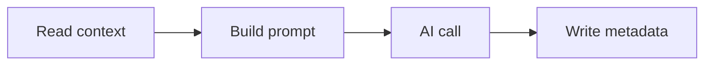

# Documentation

The project builds this site with [Zensical](https://zensical.org).
[`zensical.toml`](https://github.com/jbsilva/photo-tagger/blob/main/zensical.toml) at the repository
root configures the site. The page sources are Markdown files under `docs/`. This page explains how
to preview, build, and write those pages.

## Preview locally

Run a local development server that watches the sources and reloads on every change:

```bash
uv run poe docs
```

The local server shows the site at <http://localhost:8000>. To use another port, pass an explicit
address with `-a`:

```bash
uv run poe docs -a localhost:8001
```

## Build the static site

To produce the static HTML without serving it, run the build:

```bash
uv run poe docs-build
```

The build writes the output to `site/`, which is gitignored. The output is a build artifact, so the
project never commits it. Only the Markdown sources under `docs/` and the `zensical.toml`
configuration live in the repository.

## Publishing

[`.github/workflows/docs.yml`][docs-workflow] publishes the site automatically. On each push to
`main` that touches the docs sources, the workflow runs this build and deploys the result to GitHub
Pages:

```bash
uv run --only-group docs --locked --no-build zensical build --clean
```

Each flag has one job:

- If `uv.lock` is out of date, `--locked` makes the command fail.
- `--no-build` skips the build of the project itself (the command needs only the `docs` group).
- `--clean` wipes the output directory before the build writes to it.

<https://jbsilva.github.io/photo-tagger/> is the address of the published site.

## Page structure

The `nav` table in `zensical.toml` defines the navigation tree. It maps each page title to its
source file. To add a page, create the Markdown file under `docs/`. Then add the file to that `nav`
table.

Each page starts with a small block of YAML front matter that sets the page icon. A single H1
heading and a short intro follow it:

```markdown
---
icon: lucide/book-open-text
---

# Page title

A one to three sentence intro that says what the page covers.
```

## Authoring syntax

In addition to plain Markdown, the theme supports a few extensions. An admonition is a fenced
callout. Its body comes after a blank line, indented four spaces:

```markdown
!!! note

    This is the body of the note.
```

Content tabs group genuine alternatives behind labeled tabs:

```markdown
=== "Ollama"

    Steps for Ollama.

=== "LM Studio"

    Steps for LM Studio.
```

Mermaid diagrams render from a fenced ```` ```mermaid ```` block. This block is useful for flows on
the architecture pages:

````markdown

````

## Keeping the docs in sync with the code

Prose rots quietly. A contributor renames a flag or adds a command, and the pages still describe the
tool as it was. [`scripts/check_docs_sync.py`][check-docs-sync] guards against that. It walks the
live cyclopts app, not a hand-maintained list. It runs as a pre-commit hook each time the package or
the docs change:

```bash
uv run scripts/check_docs_sync.py
```

It enforces three rules:

- `README.md` and the [CLI reference](../usage/cli-reference.md) name every subcommand (`doctor`,
    `watch`, `undo`, `gui`).
- Every flag that the CLI accepts appears in the CLI reference, under at least one of its names.
    That page promises to document every flag, so a new flag cannot ship without documentation.
- Every flag-shaped token in the user-facing pages is a flag that the CLI really has. The
    user-facing pages are `README.md`, the site index, everything under `usage/` and
    `getting-started/`, and the telemetry and troubleshooting pages. The check skips lines that
    invoke another tool, such as `uv sync --extra gui`.

The check is about coverage, not correctness. It cannot tell that a documented default is stale or
that a description is now wrong. It also cannot see environment variables and configuration keys. If
you change behavior but not the flag surface, read the affected page again yourself.

## Style

Keep the prose consistent with the rest of the site:

- Hard-wrap prose and code at 100 columns.
- Use sentence-case headings ("Page structure", not "Page Structure"), with one H1 per page.
- Indent nested list items by four spaces.
- Link between pages with relative `.md` paths, for example [Testing](testing.md) or
    [Installation](../getting-started/installation.md). Use a `#kebab-anchor` to target a heading.
- Link to source code with absolute GitHub URLs on `main`, such as
    [`pipeline.py`](https://github.com/jbsilva/photo-tagger/blob/main/src/photo_tagger/pipeline.py).

!!! tip

    Preview the site with `uv run poe docs` before you push. The local server catches broken links and
    rendering mistakes that are easy to miss in raw Markdown. The docs deploy runs automatically after
    your change lands on `main`.

[check-docs-sync]: https://github.com/jbsilva/photo-tagger/blob/main/scripts/check_docs_sync.py
[docs-workflow]: https://github.com/jbsilva/photo-tagger/blob/main/.github/workflows/docs.yml
